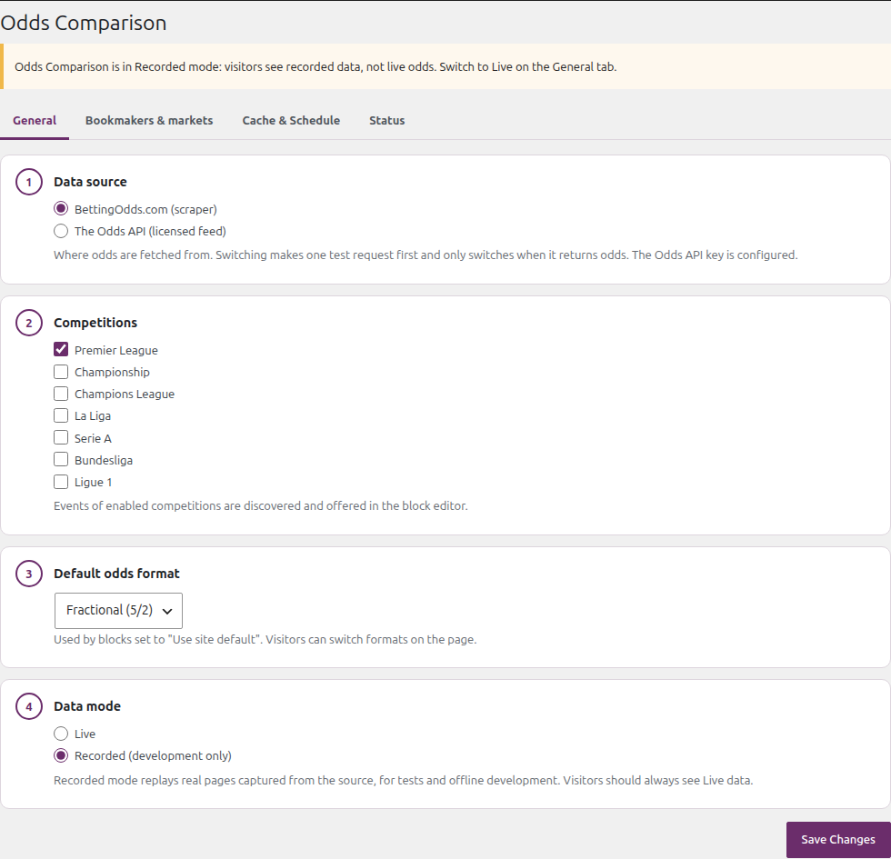
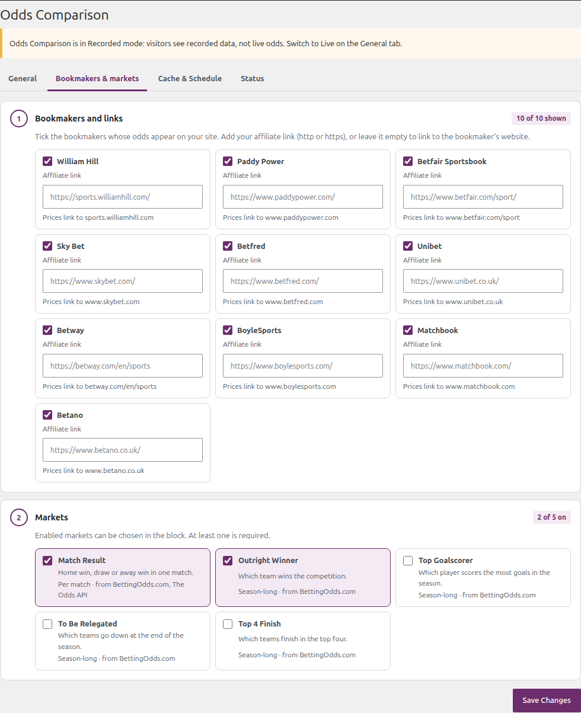
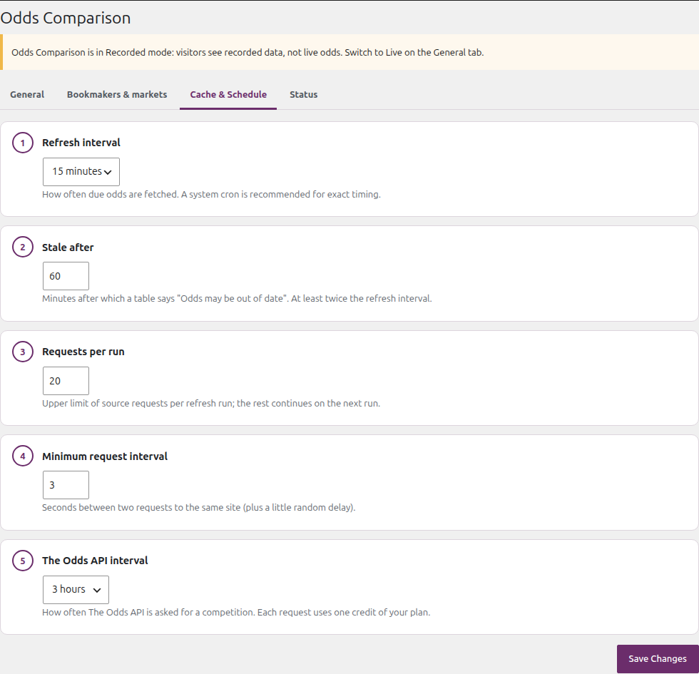
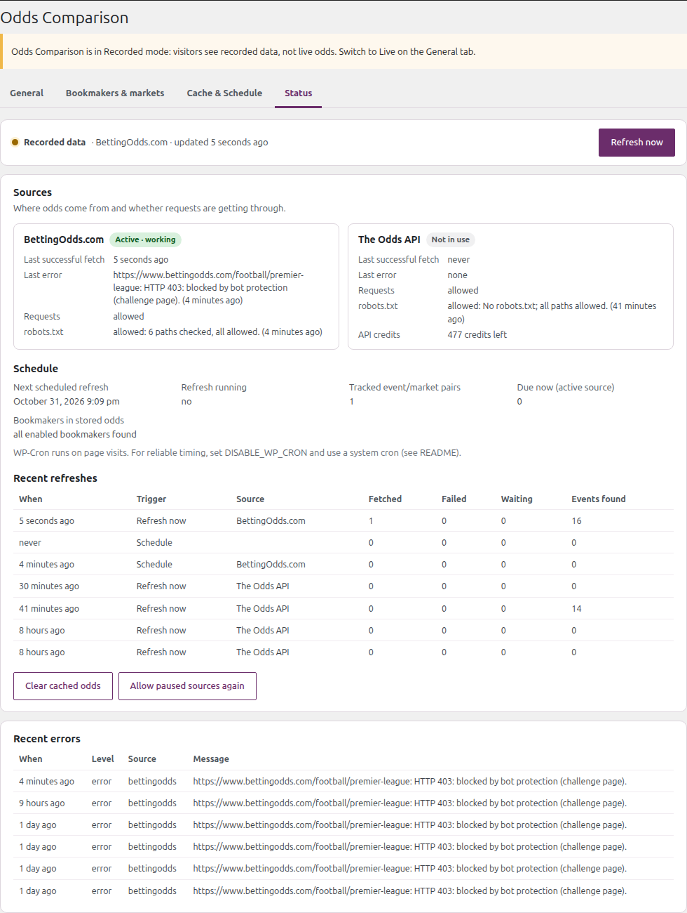
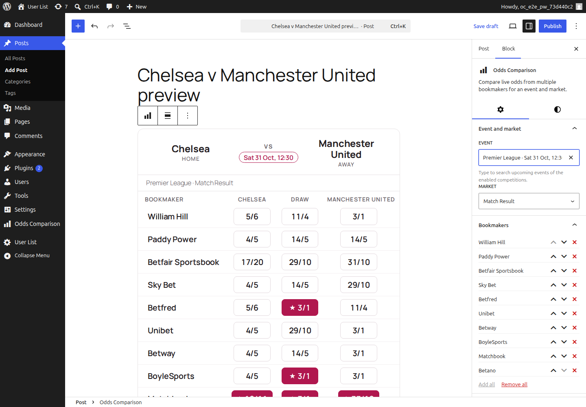
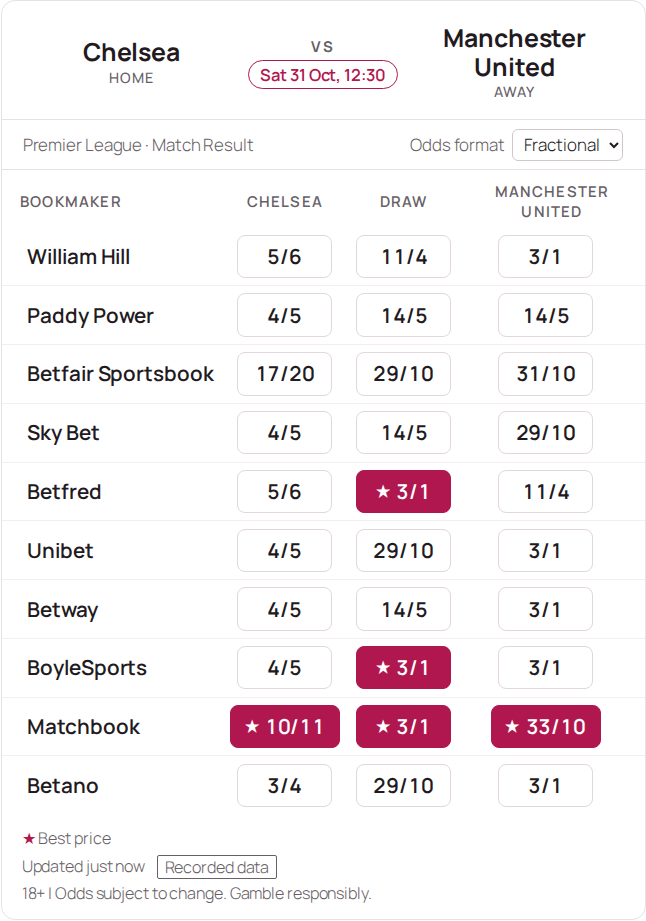
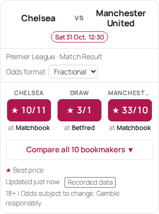

# Odds Comparison (WordPress plugin)

Compares betting odds from about 10 UK bookmakers, caches them and shows them in posts and pages with a
Gutenberg block. Admins choose the bookmakers, their affiliate links and the markets; editors pick an event and
the bookmakers for each table; visitors switch between fractional, decimal and American odds.

Odds come from one of two sources, behind the same interface:

- **BettingOdds.com scraper**: reads an existing odds comparison site, as the assignment requires. Its bot
  protection currently blocks requests from typical web servers; the Status tab then says so, and the plugin
  never tries to get around it.
- **The Odds API**: a licensed odds feed (free plan available) that works from any server. Recommended.

A new install starts with **demo data**, so the block works straight away without a key: real odds recorded
from these sources, with kick-off dates moved to the coming days (they never go out of date). Tables are marked
"Demo data". When you are ready for live odds, see [Going live](#going-live).

Odds are fetched in the background (WP-Cron) and stored. Pages only read stored odds, so a block adds a few
milliseconds and no outside requests to a page view ([measurements](TECHNICAL_DOCUMENTATION.md#performance)).

| Document | For |
|---|---|
| This README | installing, configuring and using the plugin |
| [TECHNICAL_DOCUMENTATION.md](TECHNICAL_DOCUMENTATION.md) | developers: architecture, data model, extension guide with examples, hooks, troubleshooting |

## Requirements

- WordPress 6.7 or later, PHP 8.1 or later, MySQL 5.7+ / MariaDB 10.4+.
- A persistent object cache is optional and used automatically.
- For live odds from any server: a free [The Odds API](https://the-odds-api.com) key.

## Installation

**From the release zip:** download `odds-comparison.zip` from the repository's Releases page, then in WordPress
go to **Plugins → Add New Plugin → Upload Plugin**, choose the file and activate **Odds Comparison**. The zip
includes the compiled block, the Composer autoloader and the demo data.

**From the repository:** the compiled block is committed and the plugin loads its own classes, so no build
step is needed. Clone or copy the repository into `wp-content/plugins/odds-comparison` and activate it
(**Plugins** screen, or `wp plugin activate odds-comparison`).

On activation the plugin adds its settings with defaults, starts the first refresh and schedules the next ones.
With demo data (the default) the block editor lists Premier League events within a minute or two. Uninstalling
removes all its data; deactivating keeps it.

## Configuration

After activating the plugin, open **Odds Comparison** in the WordPress admin menu. Each tab saves on its own;
saving one tab never changes the others. Problems are reported at the top of the screen, and an invalid value
keeps its previous setting. (The screenshots come from an earlier build, which labelled demo data "Recorded data";
the current build says "Demo data".)

### Going live

Demo data needs no setup. For live odds:

1. Add a free The Odds API key (next section). BettingOdds.com, the scraper source, blocks requests from most
   web servers, so on a typical host it returns no odds.
2. On the **General** tab choose **The Odds API** as the data source and set **Data mode** to
   **Live odds from the data source**, then save.

Switching between demo and live clears the stored odds and events and starts a refresh, so demo odds are never
shown as live. **Blocks that show a demo match need a new event:** live sources list other matches, so those
tables are hidden from visitors until you pick a live event in the block. The General tab tells you how many
published posts have odds tables before you switch, and afterwards the Status tab lists the posts to edit. If the live source stops responding, the Status tab and the Dashboard show the error, what to do,
and a **Use demo data** button.

### 1. Add The Odds API key (recommended)

1. Create a free account at [the-odds-api.com](https://the-odds-api.com) and copy your API key from the email.
2. Add this line to `wp-config.php` (above "That's all, stop editing!"):

   ```php
   define( 'ODDS_COMPARISON_THEODDSAPI_KEY', 'your-key-here' );
   ```

   The key is never stored in the database or shown in the admin. The **General** tab confirms
   "The Odds API key is configured".

### 2. General tab



| Setting | What to choose |
|---|---|
| Data mode | **Demo data** (the default): real recorded odds with kick-off dates moved to the coming days, no outside requests, tables marked "Demo data". **Live odds from the data source**: what visitors should see once a source works (see [Going live](#going-live)). |
| Data source | **The Odds API** for reliable live odds. Switching first makes one check request and only switches if it returns odds; otherwise the reason is shown and nothing changes. |
| Competitions | The leagues whose matches you want to offer in posts. Premier League is on by default. |
| Default odds format | Fractional (5/2), Decimal (3.50) or American (+250). Visitors can switch on the page. |

### 3. Bookmakers & markets tab



**1 · Bookmakers and links**: one tile per bookmaker.

- **Show** (the checkbox): untick bookmakers you do not want anywhere on the site.
- **Affiliate link**: your tracking link for that bookmaker (must start with `http://` or `https://`). The
  bookmaker's name in every odds table links there. Leave it empty to link to the bookmaker's website. The line
  under the field says where the name links to.

**2 · Markets**: tick the markets editors may choose. *Per match*: Match Result. *Season-long* (outright
winner, top goalscorer, relegation, top 4) are only available from the BettingOdds.com scraper.

Editors set the order of bookmakers in each block.

### 4. Cache & Schedule tab



The defaults suit most sites. *Refresh interval* is how often odds are updated (default 15 minutes). *The Odds
API interval* controls how often the API is asked per league; each request uses one credit of your plan (the
default of 3 hours keeps one league well inside the free plan). *Stale after* marks odds as possibly out of date; for The Odds API it is
never shorter than its interval plus one refresh, so on-schedule odds are not flagged. *Minimum request interval*
(2–10 seconds) is the pause between requests to a site; the help text shows how many requests a run can make.

### 5. Status tab



- The strip at the top says whether odds are flowing (Live, Not updating, Paused or Demo data), from which
  source, when they were last updated and how many API credits are left. **Refresh now** updates odds in the
  background and reports the result on the page.
- **Sources**: for each source, whether it is in use and working, its last successful fetch, the last error,
  whether requests are paused after failures, and the robots.txt check.
- **Schedule**: the next refresh, the update queue, and any enabled bookmaker that the source does not list.
- **Recent refreshes** (last 10) and **Recent errors**, which also lists data warnings: for example a page that
  no longer shows matches (its layout may have changed), or bookmakers the source lists that aren't configured.
- **Clear cached odds** removes stored odds; they are fetched again on the next refresh. **Allow paused sources
  again** lets requests to a paused source through.

## Adding odds to a post



1. In the block editor, add the **Odds Comparison** block (search "odds").
2. In the block sidebar, type to find the **Event** (only upcoming events of enabled competitions are listed)
   and pick the **Market**.
3. **Bookmakers**: the block starts with every enabled bookmaker. Remove the ones you do not want, add others
   back, or change their order with the arrow buttons.
4. Optional: **Selections** (e.g. only "Chelsea" for "Odds for Chelsea to win"), **Display** (odds format,
   best-price highlight, visitor format switcher, caption).

| Desktop | Phone |
|---|---|
|  |  |

The table shows the fixture, kick-off time and one row of prices per bookmaker; the best price for each outcome
is filled and marked with ★. On phones (narrow blocks) it first shows the best price for each outcome and where
to get it, with a **Compare all bookmakers** button for the full table.

The preview in the editor is exactly what visitors see (the phone view shows the full table). A new event shows "Odds are being fetched" until the
next background refresh (about a minute). Visitors can switch between fractional, decimal and American odds;
the choice is remembered on their device.

Themes can change the table markup by copying `templates/odds-table.php` to
`your-theme/odds-comparison/odds-table.php`, or restyle it with CSS custom properties such as `--oc-accent`,
`--oc-card-bg` and `--oc-border`.

## Reliable updates (system cron)

WordPress runs scheduled tasks only when someone visits the site. For exact timing, add
`define( 'DISABLE_WP_CRON', true );` to `wp-config.php` and run this every 5 minutes from the server's cron:

```bash
wp cron event run --due-now --path=/path/to/wordpress
```

## Assumptions

- **Football by default.** Competitions, markets and bookmakers are data, not code, so other sports are
  configuration ([extension guide](TECHNICAL_DOCUMENTATION.md#extension-guide)).
- **A block shows one event and one market.** An event is a match (Chelsea v Manchester United) or a
  competition's season-long markets (outright winner, top goalscorer, relegation, top 4).
- **Default source: BettingOdds.com**. Its address is fixed
  in the code; admins cannot enter URLs. Because it challenges server requests, live odds in practice come from
  The Odds API, which has no season-long football markets.
- **Odds are never invented.** When fetching fails, the last good odds stay, marked "may be out of date" when old.

## Legal note

The scraper only requests public pages that the site's robots.txt allows, at a low rate (3 s or more between
requests), with an honest User-Agent, and caches the results. It never uses techniques to get around bot
protection. BettingOdds.com's terms reserve copyright and restrict commercial reuse, as comparison sites
generally do: **using scraped odds on a production site needs the site owner's permission or a licence.** The
Odds API is a licensed feed; follow its terms and plan limits. Show odds responsibly: the table carries an 18+
responsible-gambling line (changeable with the `odds_comparison/disclaimer` filter), and gambling advertising
rules in your country apply.

## License

GPL-2.0-or-later — see [`LICENSE`](LICENSE).
