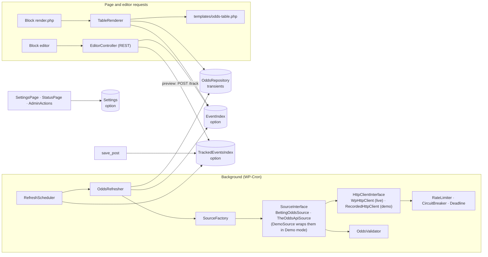

# Odds Comparison: Technical Documentation

For developers who maintain or extend the plugin. Setup and day-to-day use are in [README.md](README.md).

**Contents:** [Architecture](#architecture) · [Classes and design patterns](#classes-and-design-patterns) · [Data model](#data-model) · [Caching and freshness](#caching-and-freshness) · [Rate limits and accuracy](#rate-limits-and-accuracy) · [Extension guide](#extension-guide) · [Hook reference](#hook-reference) · [When the source's markup changes](#when-the-sources-markup-changes) · [Troubleshooting](#troubleshooting) · [Performance](#performance) · [Security](#security)

## Architecture

Odds are fetched in the background and stored. Page views only read what is stored: a block never makes an HTTP request.



### Data flow of one refresh

```mermaid
sequenceDiagram
    participant Cron as WP-Cron
    participant Sch as RefreshScheduler
    participant Ref as OddsRefresher
    participant Src as Source (AbstractSource)
    participant Http as WpHttpClient
    participant Val as OddsValidator
    participant Repo as OddsRepository
    Cron->>Sch: odds_comparison_refresh
    Sch->>Sch: take lock, start 25 s deadline, before_refresh
    Sch->>Ref: discover(source, competition)
    Ref->>Src: discoverEvents()
    Src->>Http: GET listing (throttled)
    Http-->>Src: HTML / JSON
    Src-->>Ref: Event[] → EventIndex
    loop due tracked pairs, soonest kick-off first
        Sch->>Ref: refreshPair(eventId, marketKey)
        Ref->>Src: fetchMarket(event, market)
        Src->>Http: GET market page (memoized per run)
        Src->>Src: parse → map bookmaker codes → MarketOdds
        Src->>Val: validate (range, overround, minimum quality)
        Val-->>Ref: cleaned odds or rejection
        Ref->>Ref: filter odds_comparison/market_odds
        Ref->>Repo: save (only good data; failures keep the old)
        Ref->>Ref: action odds_comparison/odds_updated
    end
    Sch->>Ref: reportDiagnostics(source)
    Ref->>Ref: source warnings and unknown codes → error log (when changed)
    Sch->>Sch: after_refresh(summary), release lock
```

A page view: `render.php` → `TableRenderer::render()` → stored event and odds → view model → template. The editor preview uses the same renderer through the REST block renderer, so editor and site show the same table. Editor hints ("Choose an event…", "Odds are being fetched…", "its event is no longer available") appear only in that preview (the last one also for logged-in users who can edit the post): `PreviewContext` marks requests to the `/wp/v2/block-renderer/odds-comparison/odds-table` route from users who can edit posts. Any other REST request that renders the block (for example `content.rendered` from `/wp/v2/posts`) gets exactly the visitor output.

The editor tracks an (event, market) pair with `POST /odds-comparison/v1/track` only after the event's market list has loaded and contains the market. The endpoint rejects pairs that can never be priced (an outrights event with Match Result, a match with an outright market, an outright market the competition does not list) with HTTP 400, so they are never queued for refreshes.

### Refresh runs

WP-Cron fires `odds_comparison_refresh` at the refresh interval (5, 15, 30 or 60 minutes). "Refresh now" on the Status tab queues the same hook once. Each run:

1. Takes the lock (`odds_comparison_lock`, an atomic `add_option`). A run that finds the lock returns at once. A lock older than 10 minutes is treated as left behind by a crashed run.
2. Fires `odds_comparison/before_refresh`.
3. Checks the active source's robots.txt once a day. The paths it disallows (competition listings, outright market pages) are skipped in steps 4 and 6 until a later check allows them; a check that fails keeps the last result.
4. Discovers the events of each enabled competition. The Odds API is discovered only once per API interval, to protect the credit quota. A listing that yields no matches while upcoming matches of that competition are stored counts as a failure (`source_failed`, Recent errors) and leaves the stored events alone, so a blank or broken page answered with HTTP 200 cannot wipe published tables.
5. Removes matches that started more than 7 days ago (`EventIndex::STARTED_RETENTION`). Until then a started match stays, so its blocks say "This event has started"; the editor never offers it as upcoming.
6. Refreshes tracked (event, market) pairs that are due, soonest kick-off first and season-long markets last.
7. Fires `odds_comparison/after_refresh` with the run summary. The summary includes `seconds`, the run's length.

A run stops at `requests_per_run` HTTP requests, or earlier when the next step would not fit the time budget (below). Requests are counted at the transport (`CountingHttpClient`), so a step answered from a page already fetched in this run (every match priced from one listing, every The Odds API pair from one response) is free and never pushes a pair into a later run that would have to request, and pay for, the page again. Whatever is left waits for the next run. A failed fetch never replaces stored odds. A failing robots.txt check (timeout, out of time, unknown source) is recorded or retried next run; it never aborts the run.

Data is due when it would expire before the next run: its age is compared with the refresh age minus half a run interval. Without that slack, odds fetched a few seconds into one run are a few seconds too young at the next run and would be refreshed only every other run.

#### Time budget

A run has a 25-second budget, below PHP's default 30-second `max_execution_time`. A shared `Support\Deadline` enforces it in two places:

- **The scheduler** starts no step that would take longer than the slowest step so far.
- **The HTTP client** limits each request's timeout to the time left. It skips a retry that could not finish in time. When a first attempt cannot start in time, it sends nothing and throws `TimeBudgetExceeded`, and that item counts as *skipped*, not *failed*. A retry cut short does count as a failure, because the request did fail.

Without this, one request to an unresponsive host could take about 61 seconds: three attempts × (up to 4 s throttle + 15 s timeout), plus 1 s and 3 s retry pauses.

#### Measured runs (2026-10-31)

WordPress 7.0, PHP 8.3, Premier League; worst case: every match and season-long market tracked and due.

| Mode | Work | Run time |
|---|---|---|
| Live, The Odds API | discovery (1 API call, 1 credit) | 4.27 s |
| Live, The Odds API | 13 match pairs (reuse the discovery response; no further calls) | 0.13 s |
| Live, BettingOdds.com | discovery and pairs answered with a 403 bot challenge; circuit opened after 3 failures | 6.97 s |
| Simulated unresponsive host (every request runs to its timeout) | 1st attempt 15 s timeout, retry limited to 8 s, remaining 7 pairs skipped | **24.07 s** |

Live scraping costs about 4–5 s per page: the 3-second minimum interval, up to 1 s jitter, and the response time. So in Live scraping mode the time budget, not `requests_per_run`, decides how much a run does: about 5 pages per run. **`requests_per_run` stays at 20.** The minimum interval is capped at 10 s (`Settings::MAX_REQUEST_INTERVAL`): a run lasts at most 25 s, so a longer pause would leave room for a single request per run. The Cache & Schedule tab shows how many requests a run can make at the current value.

For exact timing, run WP-Cron from the server (README, "Reliable updates").

## Classes and design patterns

All PHP classes live under `src/` in the `OddsComparison\` namespace (PSR-4). Hooks are added in each service's `register()` method, never in constructors.

| Namespace | Classes | Responsibility |
|---|---|---|
| (root) | `Plugin` | Singleton and composition root: builds every service, injects dependencies, calls `register()` on each, fires `odds_comparison/loaded` |
| `Contracts` | `SourceInterface`, `HttpClientInterface`, `OddsRepositoryInterface`, `HookableInterface`, `DiagnosticsInterface` (optional: sources that collect non-fatal warnings) | The seams the pipeline depends on |
| `Domain` | `Bookmaker`, `Market`, `Competition`, `Event`, `MarketOdds`, `Price`, `OddsFormat`; helpers `Assert`, `Field` | Immutable value objects, validated in their constructors |
| `Registry` | `AbstractRegistry` → `BookmakerRegistry`, `MarketRegistry`, `CompetitionRegistry` | `config/*.php` defaults + a filter → typed lookup |
| `Source` | `SourceFactory`, `AbstractSource` → `BettingOddsSource` (+ `BettingOddsParser`), `TheOddsApiSource` (+ `TheOddsApiMapper`); `DemoSource` (Demo mode decorator) | Reading odds sites |
| `Http` | `WpHttpClient`, `RecordedHttpClient`, `RateLimiter`, `CircuitBreaker`, `RobotsTxt`, `HttpResponse`, `HttpException`, `TimeBudgetExceeded` | Transport, throttling, failure handling |
| `Odds` | `OddsValidator`, `ValidationResult`, `OddsConverter` | Accuracy checks and format conversion (pure PHP) |
| `Storage` | `OddsRepository`, `EventIndex`, `TrackedEventsIndex` | Everything that is stored |
| `Scheduler` | `RefreshScheduler`, `OddsRefresher`, `CronSchedule`, `Lock`, `DataModeSwitch` | Background refresh; reset on a Demo/Live switch |
| `Block` | `BlockRegistrar`, `TableRenderer` | The `odds-comparison/odds-table` block |
| `Rest` | `EditorController`, `StatusController` | `odds-comparison/v1` routes (editor: `edit_posts`; status: `manage_options`) |
| `Admin` | `SettingsPage`, `StatusPage`, `AdminActions`, `SourceProbe`, `SourceLabels` | Admin screen |
| `Settings` | `Settings`, `SettingsSanitizer`, `SettingsEvents` | Reading, validating and announcing settings |
| `Lifecycle` | `Installer`, `Uninstaller` | Activation, upgrade, multisite, uninstall |
| `Support` | `Logger`, `StatusRecorder`, `RobotsMonitor`, `Deadline`, `OptionKeys` | Logging, status, robots.txt, run deadline, storage keys |

| Pattern | Where | What to look at |
|---|---|---|
| Singleton | `Plugin` | private constructor, `instance()`, `__clone()` private, `__wakeup()` throws. The only singleton |
| Factory | `SourceFactory::make()` | id → `SourceInterface`, from the `odds_comparison/sources` filter; an unknown id throws `InvalidArgumentException` |
| Observer | WordPress hooks | `StatusRecorder` listens to `odds_updated`, `source_failed`, `after_refresh`; `CronSchedule` and `DataModeSwitch` listen to `settings_saved` |
| Strategy | `HttpClientInterface`, `SourceInterface` | live or recorded transport, chosen by `data_mode`; any source behind one interface |
| Decorator | `DemoSource` | wraps a source in Demo mode: same prices, kick-offs moved into the coming days |
| Template Method | `AbstractSource::fetchMarket()` / `discoverEvents()` | fixed algorithm; subclasses implement `competitionUrl()`, `marketUrl()`, `parseEvents()`, `parseMarket()` |
| Registry | `AbstractRegistry` | config + filter, typed lookup |
| Repository | `OddsRepository` | all odds storage behind `OddsRepositoryInterface` |
| Value Object | `Domain/*` | `readonly` properties, validated on construction |
| Circuit Breaker | `CircuitBreaker` | closed → open (3 failures) → half-open (after `odds_comparison/circuit_breaker_seconds`, default 1 h) → closed or open |

## Data model

Everything is per site (each multisite site has its own). `Support\OptionKeys` names every key, and uninstall removes all of them.

The options that several requests update (`odds_comparison_tracked`, `odds_comparison_errors`, `odds_comparison_status`) are changed through `Support\OptionMutex`: a MySQL named lock (`GET_LOCK`) around the read-modify-write, with the value read from the database inside the lock. A cron run logging errors and an editor previewing a block at the same moment therefore cannot overwrite each other's changes. If the lock cannot be taken within 3 seconds, the change is written anyway.

Deactivation removes every event of the `odds_comparison_refresh` hook, queued manual runs included (`wp_unschedule_hook()`), and keeps the data. Uninstall also deletes the transients through the Transients API: the stored odds (found through `odds_comparison_odds_keys`), the API quota, and the circuit breaker, rate limiter and diagnostics state of the built-in sources. So they also leave a persistent object cache, where transients never reach the options table. Any other prefixed transient in the options table is removed with one prepared query.

| Key | Kind | Autoload | Contents |
|---|---|---|---|
| `odds_comparison_settings` | option | yes | `active_source`, `data_mode`, `default_odds_format`, `enabled_competitions`, `bookmakers` (per slug: `enabled`, `link`, `label`), `bookmaker_order`, `enabled_markets`, `refresh_interval`, `stale_after`, `requests_per_run`, `min_request_interval`, `api_refresh_interval` |
| `odds_comparison_version` | option | yes | plugin version (upgrade check) |
| `odds_comparison_events` | option | no | discovered events: `id`, `sourceId`, `competition`, `kind` (match/outrights), `name`, `home`, `away`, `startsAt`, `path` |
| `odds_comparison_tracked` | option | no | `eventId|marketKey` → `postIds` (posts with a block) and `previewUntil` (editor preview); unused pairs are dropped |
| `odds_comparison_odds_{md5(eventId|marketKey)}` | transient, 7 days | no | `MarketOdds`: `eventId`, `marketKey`, `sourceId`, `fetchedAt`, `selections` → `label`, `prices` → bookmaker slug → `{decimal}` |
| `odds_comparison_odds_keys` | option | no | stored odds transient name → expiry time (for "Clear cached odds"); expired and deleted entries are dropped |
| `odds_comparison_status` | option | no | per source: last success, last error, robots.txt result (with the disallowed paths that refreshes skip), competition fetch times; last 10 run summaries |
| `odds_comparison_errors` | option | no | newest 50 log entries: `time`, `level`, `source`, `message`, `count`. A repeat of the newest entry only increments `count` and updates `time` (the Status tab shows "(×9)"), so repeats cannot push real errors out |
| `odds_comparison_demo_events` | option | no | ids of the events published blocks showed when the site switched from Demo to Live (deleted on the switch back to Demo); see below |
| `odds_comparison_lock` | option | no | `{start time}:{random token}` of the running refresh, written with atomic SQL so only one run holds it |
| `odds_comparison_cb_*`, `odds_comparison_rl_*`, `odds_comparison_theoddsapi_quota` | transients | no | circuit state per host, last request time per host, API credits |

Event ids are `{source}:{competition}/{source's own id}`, e.g. `bettingodds:premier-league/4othg6zhiyox0rivijbld3swk`; outrights are `{source}:{competition}/outrights`. Only the decimal price is stored; fractional and American are derived when shown. Sources quote decimals rounded to two places, so both are derived from the exact fraction behind the decimal (the standard bookmaker fraction it rounds, e.g. 1.17 → 1/6), not from the rounded number: 1/6 is shown as −600 in American odds, not −588. A ladder fraction is used when the decimal lies in the half-open window [fraction − 0.005, fraction + 0.005), which holds exactly one two-place decimal: 3.12 is 85/40 and 3.13 is 213/100, so no two prices ever look the same, and fractional and American always agree (1.995 is 1/1 and +100).

The block stores its choices as attributes in the post: `eventId`, `marketKey`, `bookmakers` (slugs, in order), `selections`, `oddsFormat`, `highlightBest`, `showFormatSwitcher`, `caption`.

### Demo mode

`data_mode` is `demo` (the default for new installs) or `live`; `recorded`, from earlier builds, reads as
`demo`. In Demo mode:

- The composition root (`Plugin`) gives every source a `RecordedHttpClient` over `fixtures/`: real responses
  captured from BettingOdds.com and The Odds API on 2026-10-30 (Premier League: matches and four outright
  markets), shipped in the release zip and listed with checksums in each `fixtures/*/manifest.json`. No
  outside request is made, and The Odds API needs no key. Recorded HTML pages are stored as `.txt`, so a web
  server sends them as plain text and a browser never runs their scripts on the site's domain.
- Each source is wrapped in `DemoSource`. It moves every kick-off forward by whole days: the smallest number
  of days that puts the capture time at or after now (`DemoSource::dayShift()`), keeping the UK wall-clock
  time. Every recorded match is therefore upcoming, whatever the date. Prices, bookmakers and event ids are
  unchanged, and fetched odds are stamped with the real time, so caching, staleness and "started" work as in
  Live mode.
- Competitions without recorded data get no demo events (a warning in **Recent errors**). Sources added
  through `odds_comparison/sources` receive the recorded transport too, so they have no demo data unless their
  responses are recorded.
- Tables show a "Demo data" badge; the Status tab and the Dashboard show how to go live.

Switching between Demo and Live (`DataModeSwitch`, on `odds_comparison/settings_saved`) clears the stored
odds, the event index and the per-source status, then queues a refresh, so demo odds are never shown as live
and the reverse.

Demo matches are not in a live feed, so a block that showed one has nothing to show after the switch to Live:
visitors see no table, and the editor preview, the block sidebar and logged-in users who can edit the post see
why. To make this visible, the switch stores the ids of the events that published blocks showed
(`odds_comparison_demo_events`). Once live discovery has stored events, `DataModeSwitch::postsShowingDemoEvents()`
lists the posts whose blocks still point at one of those events. The Status tab and the Dashboard show a warning
with an edit link per post. Season-long events with the same id in the live feed keep working. Before the switch,
the General tab says how many published posts have odds tables.

A source is **failing** when the last request failed and there are no fresh odds (never fetched, or the last
success is older than its "stale after" time), or its circuit is open (`StatusPage::health()`). A failed request
between successful ones (one page, one market) only marks the source card "some requests failed"; the red notice
is kept for a source that delivers nothing. When the live source is failing, the admin notice offers **Use demo data** (`admin-post.php?action=odds_comparison_use_demo`, `manage_options` and
a nonce); the change goes through the settings form's own validation.

## Caching and freshness

- **Odds** are kept until replaced by newer good data. The 7-day transient expiry is only garbage collection. A failed refresh never removes them.
- **Refresh interval** (Cache & Schedule tab: 5, 15, 30 or 60 min): odds older than this are refetched on the next run. The Odds API uses its own longer interval (default 180 min) to save credits.
- **Stale after** (10–1440 min, default 60): older odds are still shown, with "Odds may be out of date". The threshold is per source and never shorter than the source's own refresh age plus one refresh interval (`Settings::staleAfterFor()`): with The Odds API fetched every 180 minutes, odds count as stale after 195 minutes, not 60. Both values can be changed in code with `odds_comparison/cache_ttl`.
- **Only what is used is fetched**: tracked pairs (blocks in posts, plus 24 hours after an editor preview), and only matches that have not started.
- **Rendered HTML** is cached in the `odds_comparison` object-cache group for 5 minutes. The key includes the attributes, the event (and whether it has started), the odds' `fetchedAt` and stale flag, the bookmaker links as returned by `odds_comparison/bookmaker_link`, the settings, the locale and the site's date, so new odds, settings or link filters show at once. Nothing in it changes by the minute: the footer shows the fetch time ("Updated 14:05", with the date on other days), not "5 minutes ago". The cache is checked before the table is built, so a hit skips the price conversions too. With a persistent object cache this cache is shared between requests; without one it only spans the request.
- **Started matches** show "This event has started" instead of old prices, for 7 days after kick-off; the editor's event list leaves them out (the block's own event is shown marked "(started)").

## Rate limits and accuracy

**Being a polite client:**

- At least 3 s (setting `min_request_interval`, 2–10) plus up to 1 s jitter between requests to the same host, kept across runs in a transient.
- One honest User-Agent (`OddsComparisonPlugin/{version} (+site URL)`), no header tricks, no evasion of bot protection.
- Retries for timeouts and 5xx after 1 s and 3 s. `Retry-After` on 429/503 pauses the host for that long (up to 1 h).
- A circuit breaker pauses a host after 3 consecutive failures (bot challenges, 401/403/429, exhausted retries) for 1 hour. 404s and pages without odds don't count: they are page problems.
- robots.txt is checked daily; the listing and outright pages it disallows are skipped by every refresh until a later check allows them.
- A run is limited to `requests_per_run` HTTP requests and a 25 s deadline (see [Refresh runs](#refresh-runs)).
- Responses are memoized per run: all matches priced from one listing cost one request.

**Accuracy (`OddsValidator`):**

1. Each price must be between 1.01 and 1001, or it is dropped.
2. Match markets: a bookmaker whose complete book has an overround (Σ 1/decimal) outside 0.98–1.40 is dropped for that market. Below 0.98 would be a sure profit inside one bookmaker, and above 1.40 is far beyond any real margin, so both mean a misread page.
3. At least 2 bookmakers must remain, every selection of a match market must be priced, and an outright needs at least 2 priced selections. Otherwise the whole result is rejected and the previous good data stays.
4. Bookmaker codes the registry doesn't know are ignored and counted. The Status tab lists the bookmakers found in stored odds, and the unknown codes are reported to the error log (below).

**Data warnings in the error log.** Sources collect non-fatal problems while they fetch: listings without matches ("the page has none or its markup changed"), unreadable kick-off times, skipped events, prices dropped by the checks above, prices quoted as unavailable, and bookmaker codes the registry doesn't know. At the end of each refresh run they are written to the error log (**Status → Recent errors**) as at most two warnings: one with the data warnings, where implausible and unavailable prices are summed into one line each, and one naming the unknown bookmaker codes. So that routine notes don't push real errors out of the 50-entry log, an entry is written only when its content changes (counts aside), and again after a day if the problem persists. A custom source gets this by extending `AbstractSource` or implementing `Contracts\DiagnosticsInterface`.
5. Scraped paths must be safe relative paths on the source's host.

**Fractions (`OddsConverter`):** exact from the decimal (3.90 → 29/10), except when the decimal is a standard bookmaker fraction rounded to two places (1.91 → 10/11, 1.67 → 4/6).

## Extension guide

Put extensions in your own plugin (or a must-use plugin), never in this plugin's files.

### 1. Add a bookmaker

```php
add_filter( 'odds_comparison/bookmakers', function ( array $bookmakers ): array {
    $bookmakers[] = [
        'slug'        => 'talksport-bet',             // your id: lowercase, hyphens
        'name'        => 'talkSPORT BET',
        'logoUrl'     => '',                          // optional https URL, shown 24×24
        'sourceCodes' => [ 'bettingodds' => 'talksportbet' ], // the code each source uses
        'defaultUrl'  => 'https://www.talksportbet.com/',     // where prices link without an affiliate link
    ];
    return $bookmakers;
} );
```

The bookmaker now has a tile on **Bookmakers & markets** (show/hide, affiliate link), can be added to blocks, and its prices are kept on the next refresh. To find a source's code, look at the Status tab's coverage or at the source's data (`data-bookmaker="talksportbet"` on BettingOdds.com, `bookmakers[].key` on The Odds API). Using an existing `slug` replaces that bookmaker.

### 2. Add a market or a competition

Markets and competitions use the same pattern. A market needs the name each source uses for it; a season-long market also needs its page path on the competition.

```php
add_filter( 'odds_comparison/markets', function ( array $markets ): array {
    $markets[] = [
        'key'           => 'to-stay-up',
        'label'         => 'To Stay Up',
        'sourceNames'   => [ 'bettingodds' => 'To Stay Up' ], // data-marketname on the page
        'selectionType' => 'outright',                         // 'three-way' for match markets
    ];
    return $markets;
} );

add_filter( 'odds_comparison/competitions', function ( array $competitions ): array {
    foreach ( $competitions as $i => $competition ) {
        if ( is_array( $competition ) && 'premier-league' === ( $competition['slug'] ?? '' ) ) {
            // "To Stay Up" is priced on the relegation page.
            $competitions[ $i ]['outrightPaths']['bettingodds']['to-stay-up'] = '/football/premier-league/relegation';
        }
    }

    $competitions[] = [
        'slug'          => 'scottish-premiership',
        'name'          => 'Scottish Premiership',
        'sport'         => 'football',
        'sourcePaths'   => [
            'bettingodds' => '/football/scottish-premiership', // listing page on the source
            'theoddsapi'  => '/v4/sports/soccer_spl/odds',
        ],
        'outrightPaths' => [],
    ];
    return $competitions;
} );
```

Then enable the market and the competition in the admin. Paths must be relative to the source's host (they are validated; full URLs are refused).

### 3. Add a source site

A source describes one site; the plugin does the rest (throttling, retries, circuit breaker, validation, storage). Extend `AbstractSource` and implement four methods. This example reads a licensed JSON feed that uses The Odds API v4 layout:

```php
// my-odds-feed/class-example-feed-source.php
use OddsComparison\Domain\Competition;
use OddsComparison\Domain\Event;
use OddsComparison\Domain\Market;
use OddsComparison\Source\AbstractSource;

final class Example_Feed_Source extends AbstractSource {
    public const ID = 'examplefeed';

    public function id(): string { return self::ID; }

    public function baseUrl(): string { return 'https://feed.example.com'; } // fixed host (no admin-entered URLs)

    protected function competitionUrl( Competition $competition ): ?string {
        $path = $competition->sourcePath( self::ID );
        return null === $path ? null : $this->baseUrl() . $path;
    }

    protected function marketUrl( Event $event, Market $market, Competition $competition ): ?string {
        // Match result only; the listing already holds its prices (fetched once per run).
        return 'h2h' === $market->sourceName( self::ID ) ? $this->competitionUrl( $competition ) : null;
    }

    protected function parseEvents( string $body, Competition $competition ): array {
        $events = [];
        foreach ( (array) json_decode( $body, true ) as $row ) {
            try {
                $events[] = Event::match(
                    self::ID,
                    $competition->slug . '/' . $row['id'],
                    $competition->slug,
                    $row['home_team'] . ' vs ' . $row['away_team'],
                    $row['home_team'],
                    $row['away_team'],
                    new DateTimeImmutable( $row['commence_time'] ),
                    (string) $competition->sourcePath( self::ID )
                );
            } catch ( Throwable $e ) {
                $this->warn( 'Skipped a feed event: ' . $e->getMessage() );
            }
        }
        return $events;
    }

    // One row per price: selection key (home/draw/away), label, the source's bookmaker code, decimal.
    protected function parseMarket( string $body, Event $event, Market $market ): array {
        $feedId = substr( $event->id, strrpos( $event->id, '/' ) + 1 );
        $rows   = [];
        foreach ( (array) json_decode( $body, true ) as $row ) {
            if ( ( $row['id'] ?? '' ) !== $feedId ) {
                continue;
            }
            foreach ( $row['bookmakers'] ?? [] as $bookmaker ) {
                foreach ( $bookmaker['markets'] ?? [] as $feed_market ) {
                    if ( 'h2h' !== ( $feed_market['key'] ?? '' ) ) {
                        continue;
                    }
                    foreach ( $feed_market['outcomes'] ?? [] as $outcome ) {
                        $selection = self::matchSelection( $event, (string) $outcome['name'] );
                        if ( null !== $selection ) {
                            $rows[] = [
                                'selection' => $selection[0],
                                'label'     => $selection[1],
                                'bookmaker' => (string) $bookmaker['key'],
                                'decimal'   => (string) $outcome['price'],
                            ];
                        }
                    }
                }
            }
        }
        return $rows;
    }
}
```

Register it, and tell the registries what the new source calls things:

```php
// my-odds-feed/my-odds-feed.php (Plugin Name: My Odds Feed)
add_action( 'plugins_loaded', function () {
    if ( class_exists( OddsComparison\Source\AbstractSource::class ) ) {
        require __DIR__ . '/class-example-feed-source.php';
    }
} );

add_filter( 'odds_comparison/sources', function ( array $sources ): array {
    // A class name is built with the shared AbstractSource constructor arguments.
    // For a source with its own dependencies, register a callable that returns the instance.
    $sources['examplefeed'] = 'Example_Feed_Source';
    return $sources;
} );

add_filter( 'odds_comparison/competitions', function ( array $competitions ): array {
    foreach ( $competitions as $i => $c ) {
        if ( is_array( $c ) && 'premier-league' === ( $c['slug'] ?? '' ) ) {
            $competitions[ $i ]['sourcePaths']['examplefeed'] = '/v4/sports/soccer_epl/odds';
        }
    }
    return $competitions;
}, 20 );

add_filter( 'odds_comparison/markets', function ( array $markets ): array {
    foreach ( $markets as $i => $m ) {
        if ( is_array( $m ) && 'match-result' === ( $m['key'] ?? '' ) ) {
            $markets[ $i ]['sourceNames']['examplefeed'] = 'h2h';
        }
    }
    return $markets;
}, 20 );

add_filter( 'odds_comparison/bookmakers', function ( array $bookmakers ): array {
    $codes = [ 'william-hill' => 'williamhill', 'paddy-power' => 'paddypower', 'sky-bet' => 'skybet' ];
    foreach ( $bookmakers as $i => $b ) {
        if ( is_array( $b ) && isset( $codes[ $b['slug'] ?? '' ] ) ) {
            $bookmakers[ $i ]['sourceCodes']['examplefeed'] = $codes[ $b['slug'] ];
        }
    }
    return $bookmakers;
}, 20 );
```

The source then appears under **General → Data source** (by its id; switching makes one check request first). For a scraped site, use `DOMDocument` with `LIBXML_NONET` as `BettingOddsParser` does, keep the selectors in one constant, and check the site's terms and robots.txt first.

### 4. Customise the output

**Template override:** copy `templates/odds-table.php` to `your-theme/odds-comparison/odds-table.php` and edit it. It receives `$args` (the view model of `TableRenderer::viewModel()`): `state`, `rows`, `columns`, `bestOffers`, `eventName`, `home`, `away`, `kickoff`, `subtitle`, `updated`, `stale`, `disclaimer` and more. Escape everything you print.

**Tables added later:** `view.js` sets up every table on the page once (`data-oc-ready`) and watches the page with a `MutationObserver`, so tables inserted later by AJAX navigation, infinite scroll or "load more" get the format switcher and the phone view's "Compare all" button too. Code that inserts tables in another way can call `window.oddsComparison.init( element )`.

**Escaping:** strings are stored and passed around as plain text (exception and log messages included) and escaped once, where they are printed. Escaping earlier shows `Brighton &amp;amp; Hove` on the page.

**Styling:** CSS custom properties on `.oc-odds`: `--oc-accent`, `--oc-accent-text`, `--oc-card-bg`, `--oc-text`, `--oc-border`, `--oc-rule`, `--oc-chip-border`, `--oc-muted`, `--oc-stale`.

**Filters:**

```php
// Add tracking parameters to every bookmaker link. Return '' for no link; anything that is not
// an http(s) URL is dropped.
add_filter( 'odds_comparison/bookmaker_link', function ( string $link, $bookmaker, $event ) {
    return '' === $link ? '' : add_query_arg( [ 'utm_source' => 'odds-table', 'utm_content' => $bookmaker->slug ], $link );
}, 10, 3 );

// Change the data before the template runs.
add_filter( 'odds_comparison/render_args', function ( array $args ): array {
    if ( 'table' === ( $args['state'] ?? '' ) ) {
        $args['subtitle'] .= ' · Prices may change';
    }
    return $args;
} );

// Wrap or post-process the final HTML (it is already escaped; keep it that way).
add_filter( 'odds_comparison/table_html', fn ( string $html ): string => '<div class="my-odds-wrapper">' . $html . '</div>' );

// Your own responsible-gambling line (plain text).
add_filter( 'odds_comparison/disclaimer', fn (): string => '18+ | BeGambleAware.org | Odds may change.' );
```

## Hook reference

All hooks are prefixed `odds_comparison/`. Filters that build registries run once per request, on first use.

| Hook | Type | Arguments | Use |
|---|---|---|---|
| `sources` | filter | `array $sources` (id ⇒ class name or callable) | add or replace a source ([example](#3-add-a-source-site)) |
| `bookmakers` | filter | `array $bookmakers` | add or change bookmakers ([example](#1-add-a-bookmaker)) |
| `markets` | filter | `array $markets` | add or change markets ([example](#2-add-a-market-or-a-competition)) |
| `competitions` | filter | `array $competitions` | add or change competitions |
| `http_args` | filter | `array $args, string $url` | change request arguments (e.g. `timeout`); the safety defaults stay. `$url` may hold an API key: never log it |
| `circuit_breaker_seconds` | filter | `int $seconds` | how long a failing host is paused (default 3600, minimum 60) |
| `cache_ttl` | filter | `array{refresh_interval:int, stale_after:int} $ttl` (minutes) | change freshness in code |
| `market_odds` | filter | `MarketOdds $odds, Event $event, Market $market` | change validated odds before they are saved |
| `bookmaker_link` | filter | `string $link, Bookmaker $bookmaker, Event $event, Market $market` | per-event links, tracking parameters |
| `render_args` | filter | `array $args, array $attributes` | change the template data |
| `table_html` | filter | `string $html, array $args` | change the final HTML |
| `disclaimer` | filter | `string $text` | responsible-gambling text |
| `loaded` | action | `Plugin $plugin` | all services are registered |
| `before_refresh` | action | `string $sourceId` | a refresh run starts |
| `after_refresh` | action | `array $summary` (`trigger`, `source`, `startedAt`, `finishedAt`, `seconds`, `discovered`, `fetched`, `failed`, `skipped`) | a refresh run ended |
| `odds_updated` | action | `string $eventId, string $marketKey, int[] $postIds` | new odds were saved |
| `source_failed` | action | `string $sourceId, WP_Error $error` | a request, parse or validation failed (stored odds unchanged) |
| `settings_saved` | action | `array $new, array $old` | the settings changed |

```php
// Purge page caches of the posts that show new odds.
add_action( 'odds_comparison/odds_updated', function ( string $event_id, string $market_key, array $post_ids ) {
    foreach ( $post_ids as $post_id ) {
        clean_post_cache( $post_id );           // or your page-cache plugin's purge function
    }
}, 10, 3 );

// Alert when a source keeps failing.
add_action( 'odds_comparison/source_failed', function ( string $source_id, WP_Error $error ) {
    error_log( sprintf( 'Odds source %s failed: %s', $source_id, $error->get_error_message() ) );
}, 10, 2 );

// Record run lengths.
add_action( 'odds_comparison/after_refresh', function ( array $summary ) {
    update_option( 'my_last_odds_run_seconds', $summary['seconds'], false );
} );

// Drop one bookmaker's prices from a market before saving.
add_filter( 'odds_comparison/market_odds', function ( OddsComparison\Domain\MarketOdds $odds ) {
    $selections = $odds->selections;
    foreach ( $selections as $key => $selection ) {
        unset( $selections[ $key ]['prices']['matchbook'] );
    }
    return $odds->withSelections( $selections );
} );

// Treat odds as stale only after 2 hours (overrides the admin value in code).
add_filter( 'odds_comparison/cache_ttl', fn ( array $ttl ): array => [ 'stale_after' => 120 ] + $ttl );

// Longer request timeout.
add_filter( 'odds_comparison/http_args', fn ( array $args ): array => [ 'timeout' => 20 ] + $args );
```

## When the source's markup changes

The BettingOdds.com parser reads data attributes, not layout, so most redesigns don't affect it. The first sign of a change is usually a warning under **Status → Recent errors**: "No matches found in the listing; the page has none or its markup changed", or prices of a market no longer being found. If tables then come back empty and the errors say "rejected: only 0 bookmaker(s) with valid prices", the markup has changed: update `BettingOddsParser::SELECTORS` (XPath for listing days, match items, links and times; data attributes for prices). Every selector lives in that one constant, so a markup change is a one-place fix.

## Troubleshooting

| Symptom | Cause and fix |
|---|---|
| A block shows nothing after switching to Live (editors see "its event is no longer available") | It showed a demo match, which the live feed doesn't list. The Status tab lists these posts; choose a live event in each block. |
| No odds after switching to Live | The admin notice names the source's error and offers **Use demo data**. For live odds, configure The Odds API (README, "Going live"). |
| Status tab: **Paused** for a source, "blocked by bot protection (challenge page)" | The site challenges server requests (BettingOdds.com does this to most servers). The plugin never tries to get around it. Switch **General → Data source** to The Odds API, or use demo data meanwhile. After fixing a cause, use **Allow paused sources again**. |
| "Demo data has no recorded odds for …" in Recent errors | Demo data covers the Premier League only. Disable other competitions while in Demo mode, or go live. |
| A block shows "Odds temporarily unavailable" | No good odds stored yet for that event and market, or the market was disabled. Check the Status tab's errors; use **Refresh now**. |
| The editor says "Odds are being fetched" for a long time | WP-Cron didn't run: no visits, or `DISABLE_WP_CRON` without a server cron. Set up the system cron (README) or use **Refresh now**. |
| "This event has started" | Expected: prices are removed at kick-off. The notice shows for 7 days; after that the match leaves the index and the block shows nothing. |
| "… listing returned no matches although N upcoming match(es) are stored" | The source answered with a page without matches (blank, blocked or changed). Stored events and odds were kept. If it persists, see "When the source's markup changes". |
| "Odds may be out of date" | Odds are older than **Stale after** (for The Odds API: its interval plus one refresh interval, if longer): refreshes are failing (Status tab) or cron isn't running. |
| The Odds API: "key is not configured" | Define `ODDS_COMPARISON_THEODDSAPI_KEY` in `wp-config.php` (README). |
| The Odds API: "quota is nearly exhausted" | Few credits left; the plugin stops calling the API to keep a reserve. Raise **Cache & Schedule → The Odds API interval** or upgrade the plan. |
| Cron not running at all | `wp cron event list` must show `odds_comparison_refresh`. The plugin re-creates it on the next page load if another tool removed it. |
| A bookmaker never has prices | The source doesn't price it, or its code is wrong. The Status tab lists the bookmakers found in stored odds, and **Recent errors** names the codes the source lists that no configured bookmaker uses: the right code is usually among them. |

## Performance

### Page performance

Measured on a published post with three blocks (two Match Result, one Outright Winner, 10 bookmakers each), warm cache, theme Twenty Twenty-Five, opcache on: time spent in each block's `render_block` and outbound HTTP requests per page view. Medians of 30 page loads:

| Measure | Budget | Result |
|---|---|---|
| Block 1 (Match Result; first block, loads the event index) | < 5 ms | 3.11 ms |
| Block 2 (Match Result) | < 5 ms | 1.82 ms |
| Block 3 (Outright Winner, top 10 of 20 selections) | < 5 ms | 2.61 ms |
| Three blocks together | < 10 ms | 7.5 ms |
| Outbound HTTP requests per page view | 0 | 0 |
| Database queries per block | — | 2, 1, 1 (event index, one transient per block) |
| Frontend CSS | < 5 KB gz | 1,903 B gz |
| Frontend JS | < 2 KB gz | 510 B gz |
| Assets on a page without the block | none | none |

Before tuning, the same page measured 3.79, 2.50 and 5.56 ms (11.75 ms in total). Three changes brought it within budget, and the HTML output is unchanged:

- Outright tables build only the 10 rows they show (they built all 20 before).
- Each price is formatted once per format; the visible text reuses one of the three.
- `OddsConverter` remembers fractions per decimal within a request.

**Whole-page cost.** The page with three blocks loads about 20 ms slower than the same post without them. 7.5 ms of that is the blocks. The rest is WordPress core running its text filters (`wptexturize`, `wp_filter_content_tags`, shortcodes) over the extra 111 KB of HTML: once for the post content, and again for the block template in block themes. That share grows with the HTML size, mostly the outright table (61 KB for 100 price cells).

#### Stored data

| Option | Autoload |
|---|---|
| `odds_comparison_settings` | yes (read on every request) |
| `odds_comparison_version` (5 bytes) | yes (read on every request by the upgrade check) |
| events, tracked pairs, status, errors, odds keys, lock | no |
| odds, rate-limit and quota transients | no (transients with an expiry) |


## Security

### Security audit

Audited 2026-10-31, file by file: request input (`$_GET`/`$_POST`/`$_REQUEST`/`$_SERVER`), output (`echo`/`print`), outbound requests, database access, `unserialize`/`eval`/`exec`, and every `phpcs:ignore`.

| Risk | Result | Where |
|---|---|---|
| XSS | ✅ Every value is escaped at output. The `phpcs:ignore` escaping exceptions (nine) print `get_block_wrapper_attributes()` output or strings built only from escaped parts. The parser stores `textContent` (plain text) only, so `<script>`/`onerror` in a scraped label or the caption comes out as text | `templates/odds-table.php`, `src/Admin/*` |
| SQLi | ✅ Raw queries only in two places, all through `$wpdb->prepare` with fixed table names from `$wpdb`: uninstall's prefixed transient delete (with `esc_like`) and the refresh lock's atomic insert/compare-and-swap/delete | `src/Lifecycle/Uninstaller.php`, `src/Scheduler/Lock.php` |
| CSRF | ✅ Settings go through `options.php` (`settings_fields()` nonce). admin-post actions call `check_admin_referer()`. Admin and editor JS use `apiFetch` (`X-WP-Nonce`) | `src/Admin/SettingsPage.php`, `src/Admin/AdminActions.php` |
| AuthZ | ✅ Every REST route has a `permission_callback`: `manage_options` for `/status` and `/refresh`, `edit_posts` for the editor routes. No public routes. admin-post handlers check `manage_options` before the nonce | `src/Rest/*`, `src/Admin/AdminActions.php` |
| SSRF | ✅ Base URLs are constants. Scraped paths pass `Assert::relativePath()`: `@`, `:`, `//`, `..`, `#` and whitespace are rejected, so the host cannot change. Requests use `wp_safe_remote_get` (`reject_unsafe_urls`). Recorded files are opened via `basename()` and shipped as `.txt`/`.json`, never as HTML | `src/Domain/Assert.php`, `src/Source/*`, `src/Http/*` |
| Untrusted HTML | ✅ `DOMDocument` with `libxml_use_internal_errors(true)` and `LIBXML_NONET`; 4 MB response cap | `src/Source/BettingOdds/BettingOddsParser.php`, `src/Http/WpHttpClient.php` |
| Bad links | ✅ Saved affiliate links: `esc_url_raw` with `http`/`https` only. **Fixed:** links returned by the `odds_comparison/bookmaker_link` filter now get the same rule; a `javascript:` link used to render as `<a href="">` and now shows the bookmaker's name without a link | `src/Settings/SettingsSanitizer.php`, `src/Block/TableRenderer.php` |
| Input integrity | ✅ Settings: merge-on-save sanitizer with allowlisted enums and clamped numbers. REST arguments: typed schemas with patterns and length limits. `tab` and `oc_notice` query values are allowlisted | `src/Settings/SettingsSanitizer.php`, `src/Rest/EditorController.php` |
| Unbounded storage | **Fixed:** tracked pairs that no post uses and whose editor preview has expired used to stay in `odds_comparison_tracked` forever. They are now dropped on every save | `src/Storage/TrackedEventsIndex.php` |
| Direct file access | ✅ `defined('ABSPATH') \|\| exit;` in every shipped PHP file. `uninstall.php` checks `WP_UNINSTALL_PLUGIN`. The generated `build/odds-table/*.asset.php` files only return an array | all `src/`, `templates/`, `blocks/` |
| Logging | ✅ 50 entries, autoload off, messages capped at 500 characters, API keys redacted. **Hardened:** keys are also redacted from transport errors kept by the circuit breaker and from failures passed to the Status record and `odds_comparison/source_failed` | `src/Support/Logger.php`, `src/Http/WpHttpClient.php`, `src/Scheduler/OddsRefresher.php` |
| Secrets | ✅ The API key is read only from the `ODDS_COMPARISON_THEODDSAPI_KEY` constant or environment variable. It never reaches options, REST responses or script data | `src/Plugin.php` |

#### Behaviour on source failures

What happens when the source fails, starting from a cache that already holds good odds:

| Failure | Refreshes | Stored odds | Block | Circuit | Admin sees |
|---|---|---|---|---|---|
| 403 bot challenge (`cf-mitigated: challenge`, empty body) | all fail | unchanged | still shows prices | opens after 3 failures; then no requests | error log, last error, Status "Paused" |
| Real page without odds (e.g. a stats page) | all fail validation | unchanged | still shows prices | stays closed (a page problem, not an outage) | error log, last error |
| Timeout (`cURL error 28`) | all fail after retries | unchanged | still shows prices | opens; then no requests | error log, last error, Status "Paused" |

